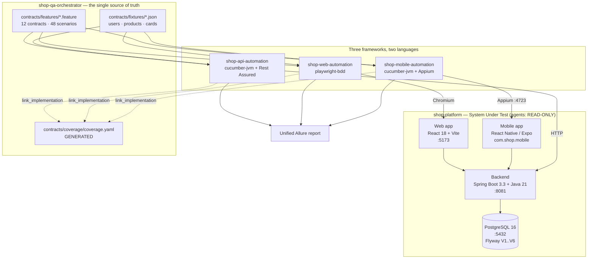
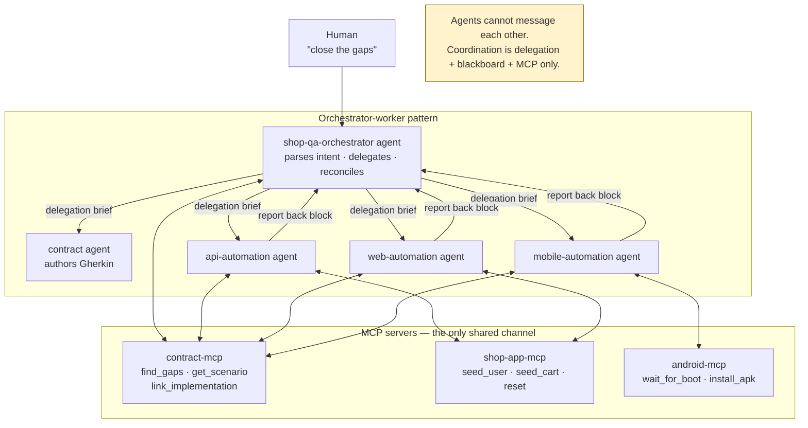
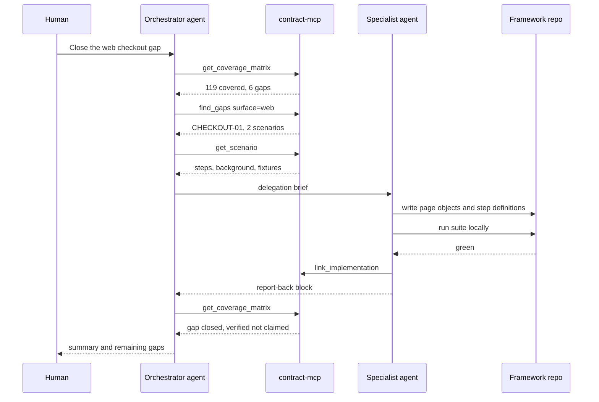
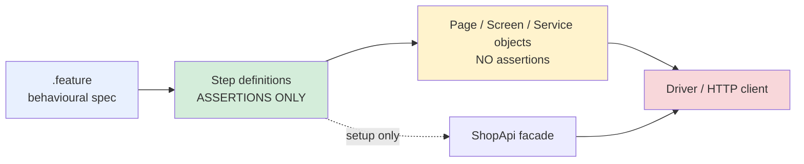
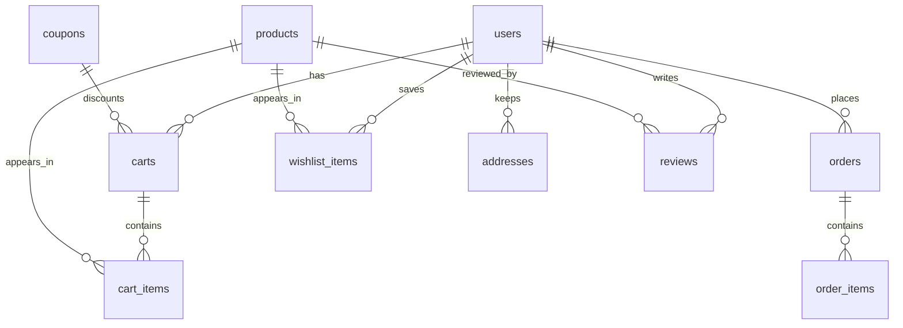

# Shop QA Platform &mdash; Engineering Handbook

> **One Gherkin spec, three frameworks, two languages, orchestrated by a fleet of agents.**

_Generated 2026-10-26T17:41:28.287Z from the live repositories and contract layer._

## 1. At a glance

| Metric | Value |
|---|---|
| Repositories | 5 |
| Contracts (journeys) | 12 |
| Scenarios | 48 |
| Matrix cells covered | 119 |
| Open gaps | 6 |
| Not applicable | 19 |
| Surfaces | api, web, mobile |
| Languages | Java 21, TypeScript |

## 2. Architecture

### 2.1 System topology



### 2.2 Agent orchestration



### 2.3 Closing a gap, end to end



### 2.4 Framework layering (strict)



Step definitions assert. Page/Screen/Service objects interact and wait. Neither does the other&rsquo;s job.

### 2.5 Data model



## 3. Repositories and components

### shop-platform

**Role.** System under test. Agents have READ-ONLY access.

**Stack.** Spring Boot 3.3.5 &middot; Java 21 &middot; PostgreSQL 16 &middot; React 18 + Vite &middot; React Native (Expo)

| Component | Responsibility |
|---|---|
| `backend/` | Spring Boot API. 12 domains, Flyway V1&ndash;V6, JWT, springdoc OpenAPI, Actuator. |
| `backend/.../testsupport/` | Triple-gated fixture endpoints: `@Profile("test")` + `X-Test-Token` + per-user scoping. |
| `web/` | React SPA. `data-testid` on every interactive element. |
| `mobile/` | Expo React Native app. `testID` on every interactive element. |
| `packages/types/` | TypeScript types generated from the live OpenAPI document. |

### shop-qa-orchestrator

**Role.** QA centre of excellence: contracts, MCP servers, agents, CI.

**Stack.** Node 22 &middot; @cucumber/gherkin &middot; MCP SDK

| Component | Responsibility |
|---|---|
| `contracts/features/` | The ONLY copy of the Gherkin. 12 contracts, 48 scenarios. |
| `contracts/fixtures/` | Single source of test data: users, products, cards. |
| `contracts/coverage/coverage.yaml` | GENERATED by `link_implementation`. Never hand-edited. |
| `mcp/contract-mcp/` | Traceability MCP + `selftest.js` and `smoke.js`. |
| `mcp/shop-app-mcp/` | Test data management MCP. |
| `mcp/android-mcp/` | Emulator lifecycle MCP. |
| `.github/agents/` | Five agent definitions. |
| `ci/` | Jenkins pipeline + job XML, TestLink compose. |
| `scripts/merge-allure.ps1` | Merges three surfaces into one Allure report. |
| `scripts/start-env.ps1` | Checks prerequisites, starts the Docker stack, emulator and Appium, and installs the released APK. |

### shop-api-automation

**Role.** API BDD suite.

**Stack.** cucumber-jvm 7.20.1 &middot; Rest Assured 5.5.0 &middot; JUnit Platform &middot; Allure

| Component | Responsibility |
|---|---|
| `steps/` | Assertions only. No URLs, no request building. |
| `support/ShopApi.java` | Facade. The single dependency of the step layer. |
| `services/*Api.java` | Request building. No assertions. |
| `fixtures/Fixtures.java` | Repository over the shared fixture files. |
| `context/ScenarioContext.java` | Per-scenario state, injected by PicoContainer. |
| `hooks/Hooks.java` | `@BeforeAll` stock replenish; `@After` attaches the request/response dump. |

### shop-web-automation

**Role.** Web BDD suite.

**Stack.** playwright-bdd 9.2 &middot; Playwright 1.62 &middot; allure-playwright

| Component | Responsibility |
|---|---|
| `src/steps/` | Assertions only. |
| `src/pages/` | Page and component objects. Interactions and waits only. |
| `src/fixtures/test.ts` | Playwright fixtures &mdash; the DI container. Must be listed in `steps`. |
| `src/api/ShopApi.ts` | Facade used only to seed state. |
| `playwright.config.ts` | `bddgen` config, `missingSteps: skip-scenario`, `workers: 1`. |

### shop-mobile-automation

**Role.** Android BDD suite.

**Stack.** cucumber-jvm 7.20.1 &middot; Appium java-client 9.4.0 &middot; Selenium pinned 4.26.0

| Component | Responsibility |
|---|---|
| `steps/` | Assertions only. |
| `screens/` | Screen objects. `BaseScreen.byTestId` wraps `UiSelector.resourceId`. |
| `driver/DriverManager.java` | ThreadLocal driver factory. |
| `hooks/Hooks.java` | Clears app data per scenario; attaches screenshot, page source, logcat. |

## 4. The contract layer

Feature files live in **one place only**: `shop-qa-orchestrator/contracts/features`. No framework owns a copy.

Rules that are enforced mechanically by `mcp/contract-mcp/selftest.js`:

- Every scenario carries a contract id, a priority and at least one surface tag.
- No step text is used as both a setup and an assertion.
- The reserved gaps stay declared but unlinked.

A surface tag **declares intent to cover**. An untagged surface reports `n/a`; a tagged but unlinked surface reports `gap`. That distinction is what makes `find_gaps` meaningful.

## 5. Traceability matrix

| Contract | Journey | Scenarios | api | web | mobile | TestLink |
|---|---|---|---|---|---|---|
| **ADDRESS-01** | Managing delivery addresses | 4 | covered | covered | covered | SHOP-9 |
| **ADMIN-01** | Administering the catalog | 4 | covered | covered | covered | SHOP-12 |
| **AUTH-01** | Creating an account | 3 | covered | covered | covered | SHOP-5 |
| **AUTH-02** | Account access | 4 | covered | covered | covered | SHOP-1 |
| **CART-01** | Managing the cart | 5 | covered | covered | GAP | SHOP-3 |
| **CATALOG-01** | Browsing the catalog | 5 | covered | covered | covered | SHOP-2 |
| **CHECKOUT-01** | Checking out | 4 | covered | GAP | GAP | SHOP-4 |
| **COUPON-01** | Applying a discount coupon | 5 | covered | covered | covered | SHOP-10 |
| **ORDERS-01** | Reviewing past orders | 3 | covered | covered | covered | SHOP-7 |
| **PRODUCT-01** | Viewing a product | 3 | covered | covered | covered | SHOP-6 |
| **REVIEWS-01** | Reviewing a product | 4 | covered | covered | covered | SHOP-11 |
| **WISHLIST-01** | Saving products for later | 4 | covered | covered | covered | SHOP-8 |

**Open gaps: 6.** These are deliberate &mdash; they are the work the orchestrator fans out to specialists, and at least one is reserved to be filled live.

| Gap | Scenarios |
|---|---|
| CART-01 @mobile | 2 |
| CHECKOUT-01 @mobile | 2 |
| CHECKOUT-01 @web | 2 |

## 6. Test details

### ADDRESS-01 &mdash; Managing delivery addresses

`address.feature` &middot; priority P2 &middot; TestLink SHOP-9

| Scenario | Surfaces | Steps |
|---|---|---|
| The first saved address becomes the default | api, web, mobile | 3 |
| A second address does not displace the default | api, web, mobile | 4 |
| The default can be switched | api, web, mobile | 5 |
| Deleting the default promotes another address | api, web, mobile | 5 |

### ADMIN-01 &mdash; Administering the catalog

`admin.feature` &middot; priority P2 &middot; TestLink SHOP-12

| Scenario | Surfaces | Steps |
|---|---|---|
| An administrator sees every product | api, web, mobile | 3 |
| An ordinary shopper is refused | api, web | 3 |
| An administrator can change stock | api, web, mobile | 3 |
| Hiding a product removes it from the shopper catalog | api, web, mobile | 4 |

### AUTH-01 &mdash; Creating an account

`registration.feature` &middot; priority P1 &middot; TestLink SHOP-5

| Scenario | Surfaces | Steps |
|---|---|---|
| Register a brand new account | api, web, mobile | 3 |
| Registering an email that is already taken is refused | api, web, mobile | 3 |
| A new account starts with an empty cart | api | 3 |

### AUTH-02 &mdash; Account access

`auth.feature` &middot; priority P1 &middot; TestLink SHOP-1

| Scenario | Surfaces | Steps |
|---|---|---|
| Sign in with valid credentials | api, web, mobile | 3 |
| Sign in is rejected with the wrong password | api, web, mobile | 4 |
| Sign out ends the session | api, web, mobile | 3 |
| A protected resource cannot be reached without signing in | api | 3 |

### CART-01 &mdash; Managing the cart

`cart.feature` &middot; priority P1 &middot; TestLink SHOP-3

| Scenario | Surfaces | Steps |
|---|---|---|
| Add a product to the cart | api, web, mobile | 3 |
| Increase the quantity of a cart line | api, web, mobile | 4 |
| Remove a product from the cart | api, web, mobile | 3 |
| Adding the same product twice merges into one line | api, web, mobile | 4 |
| Reducing a quantity to zero removes the line | api | 3 |

### CATALOG-01 &mdash; Browsing the catalog

`catalog.feature` &middot; priority P1 &middot; TestLink SHOP-2

| Scenario | Surfaces | Steps |
|---|---|---|
| Browse every product | api, web, mobile | 2 |
| Search narrows the catalog by name | api, web, mobile | 3 |
| Filter the catalog by category _(outline, 4 examples)_ | api, web, mobile | 2 |
| Clearing the filters restores the full catalog | api, web, mobile | 3 |
| A search with no matches reports an empty catalog | api, web, mobile | 3 |

### CHECKOUT-01 &mdash; Checking out

`checkout.feature` &middot; priority P1 &middot; TestLink SHOP-4

| Scenario | Surfaces | Steps |
|---|---|---|
| Pay with an approved card | api, web, mobile | 4 |
| A declined card does not place an order | api, web, mobile | 4 |
| A card with insufficient funds does not place an order | api | 3 |
| Checking out an empty cart is refused | api | 4 |

### COUPON-01 &mdash; Applying a discount coupon

`coupon.feature` &middot; priority P2 &middot; TestLink SHOP-10

| Scenario | Surfaces | Steps |
|---|---|---|
| A valid coupon reduces the total | api, web, mobile | 3 |
| A coupon below its minimum order is refused | api, web, mobile | 2 |
| An inactive coupon is refused | api, web, mobile | 2 |
| An unknown coupon is refused | api, web, mobile | 2 |
| A coupon can be removed | api, web, mobile | 3 |

### ORDERS-01 &mdash; Reviewing past orders

`orders.feature` &middot; priority P1 &middot; TestLink SHOP-7

| Scenario | Surfaces | Steps |
|---|---|---|
| A placed order appears in my history | api, web, mobile | 3 |
| Order history is empty for a shopper who has never bought anything | api, web, mobile | 4 |
| One shopper cannot see another shopper's order | api | 3 |

### PRODUCT-01 &mdash; Viewing a product

`product.feature` &middot; priority P2 &middot; TestLink SHOP-6

| Scenario | Surfaces | Steps |
|---|---|---|
| Open a product from the catalog | api, web, mobile | 3 |
| A product shows its category and stock state | api, web, mobile | 3 |
| Requesting a product that does not exist is refused | api | 2 |

### REVIEWS-01 &mdash; Reviewing a product

`reviews.feature` &middot; priority P2 &middot; TestLink SHOP-11

| Scenario | Surfaces | Steps |
|---|---|---|
| A buyer can review what they bought | api, web, mobile | 4 |
| Reviewing again edits the existing review | api, web, mobile | 5 |
| A shopper who never bought the product cannot review it | api | 2 |
| Reviews are readable without signing in | api, web, mobile | 5 |

### WISHLIST-01 &mdash; Saving products for later

`wishlist.feature` &middot; priority P2 &middot; TestLink SHOP-8

| Scenario | Surfaces | Steps |
|---|---|---|
| Save a product for later | api, web, mobile | 3 |
| Saving the same product twice keeps one entry | api, web, mobile | 3 |
| Remove a saved product | api, web, mobile | 3 |
| Removing a product that was never saved is refused | api | 2 |

## 7. Running the tests

### 7.1 Prerequisites

| Tool | Version | Needed by |
|---|---|---|
| JDK | 21 (Temurin) | API + mobile suites, backend |
| Node | 20+ | web suite, MCP servers |
| Docker Desktop | any recent | Docker stack (Postgres, backend, web), CI |
| Android SDK + emulator | API 35 | mobile suite only |
| Appium | 3.x + uiautomator2 | mobile suite only |

`start-env.ps1` checks these first and lists everything that is missing, with where to get it. Docker, `adb`, the emulator, Appium and its `uiautomator2` driver are required (the last four unless you pass `-SkipMobile`). JDK 21, Maven and Node 20+ only produce a warning, because the Docker stack does not need them; they are needed to run the suites, and are required with `-Native`.

Verify the JDK with `mvn -v` &mdash; it must report `Java version: 21`. A bare `java -version` can report a different JDK if the machine PATH shadows it; that is harmless because Maven and Gradle use `JAVA_HOME`.

### 7.2 Start the environment

**One command (Windows).** Start Docker Desktop and run:

```powershell
powershell -ExecutionPolicy Bypass -File shop-qa-orchestrator/scripts/start-env.ps1
```

Run it from the repo root (the folder you cloned). Use forward slashes as shown; they work in PowerShell, cmd and Git Bash, where backslashes are swallowed.

It checks prerequisites first, then starts only what is not already healthy and waits on each health check before moving on. By default it runs the Docker stack from the repo-root `docker-compose.yml`, and gets the APK from the repo&rsquo;s GitHub Release, verified against a SHA-256. Re-running it is safe.

| Option | Effect |
|---|---|
| _(none)_ | Docker stack (Postgres, backend, web), emulator, Appium; downloads and installs the released APK if the app is not on the emulator |
| `-SkipMobile` | Docker stack only: no emulator, Appium or APK |
| `-Native` | Run backend and web from source instead of Docker (needs JDK 21, Maven, and `npm ci` in `shop-platform/web`) |
| `-BuildApk` | Build the release APK with Gradle instead of downloading it (needs the generated `android/` folder) |
| `-ReinstallApk` | Install the APK even if `com.shop.mobile` is already on the emulator |
| `-Avd <name>` | Use a different AVD (default `shop_test`). Created automatically when missing, if the Android SDK Command-line Tools are installed |
| `-SystemImage <id>` | System image used when the AVD has to be created (default `system-images;android-35;google_apis;x86_64`, or `arm64-v8a` on ARM) |

**Docker stack only.** From the repo root, `docker compose up -d --build` starts Postgres, the backend (:8081) and the web app (:5173); `docker compose down` stops it (`-v` also wipes the database). Every credential in the compose file is a demo value for local use only. The repo root also holds `docker/web.Dockerfile` and a `README.md` quick start.

**Manual steps.** Run each from the Shop root. PowerShell does not accept the bash `VAR=value command` form; set `$env:VAR` first.

| Step | bash (macOS / Linux / CI) | Windows PowerShell | Notes |
|---|---|---|---|
| Stack (Docker, default) | `docker compose up -d --build` | `docker compose up -d --build` | Run from the repo root. Postgres + backend + web; web :5173, API :8081. `docker compose down` stops it (`-v` wipes the database) |
| Postgres (native) | `cd shop-platform && docker compose up -d postgres` | `cd shop-platform; docker compose up -d postgres` | Only for `-Native`. Docker Desktop must be running |
| Backend (native) | `cd shop-platform/backend && SPRING_PROFILES_ACTIVE=test mvn spring-boot:run` | `cd shop-platform\backend; $env:SPRING_PROFILES_ACTIVE="test"; mvn spring-boot:run` | Serves :8081; Flyway migrates on start |
| Web app (native) | `cd shop-platform/web && VITE_API_BASE_URL=http://localhost:8081 npx vite dev --port 5173` | `cd shop-platform\web; $env:VITE_API_BASE_URL="http://localhost:8081"; npx vite dev --port 5173` | Serves :5173 |
| Emulator | `emulator -avd shop_test -no-boot-anim -gpu swiftshader_indirect` | `emulator -avd shop_test -no-boot-anim -gpu swiftshader_indirect` | Then poll `adb shell getprop sys.boot_completed` until `1` |
| Appium | `appium --port 4723` | `appium --port 4723` | Required by the mobile suite only |
| Mobile APK (released) | Download `app-release.apk` from the repo&rsquo;s GitHub Releases page, then `adb install -r app-release.apk` | Download `app-release.apk` from the repo&rsquo;s GitHub Releases page, then `adb install -r app-release.apk` | Package `com.shop.mobile`. `start-env.ps1` does this and checks the SHA-256 |
| Mobile APK (build) | `cd shop-platform/mobile/android && NODE_ENV=production ./gradlew assembleRelease` | `cd shop-platform\mobile\android; $env:NODE_ENV="production"; .\gradlew.bat assembleRelease` | Release only &mdash; a debug APK renders an empty shell. The `android/` folder is generated by `npx expo prebuild --platform android`, not stored in the repo |

If you cannot type into the emulator with the PC keyboard, the AVD has `hw.keyboard = no` in `%USERPROFILE%\.android\avd\shop_test.avd\config.ini`. Set it to `yes` and cold boot (`adb emu kill`, then start with `-no-snapshot-load`). If clicking a field shows a small floating toolbar instead of the keyboard, run `adb shell settings put secure stylus_handwriting_enabled 0`. `start-env.ps1` applies both.

**Once running:**

| What | URL |
|---|---|
| Web app | <http://localhost:5173> |
| Backend health | <http://localhost:8081/actuator/health> |
| Swagger UI (API endpoints) | <http://localhost:8081/swagger-ui.html> |
| OpenAPI JSON | <http://localhost:8081/v3/api-docs> |
| Appium status | <http://127.0.0.1:4723/status> |

### 7.3 Run a suite

| Suite | Repository | Command | Requires | Expected |
|---|---|---|---|---|
| API | shop-api-automation | `mvn -B test` | backend :8081 | 51 scenarios |
| Web | shop-web-automation | `npx bddgen && npx playwright test` | web :5173 + backend | 40 passed, 2 skipped |
| Mobile | shop-mobile-automation | `mvn -B test` | emulator + Appium + backend | 37 scenarios |
| Merged report | shop-qa-orchestrator | `pwsh scripts/merge-allure.ps1` | any suite already run | one Allure report |

### 7.4 Configuration

Every value is env-overridable; nothing is hardcoded to localhost.

| Variable | Default | Used by |
|---|---|---|
| `SHOP_API_BASE_URL` | `http://localhost:8081` | all three suites |
| `WEB_BASE_URL` | `http://localhost:5173` | web suite |
| `APPIUM_URL` | `http://127.0.0.1:4723` | mobile suite |
| `TEST_SUPPORT_TOKEN` | `local-test-token` | seeding endpoints |
| `CONTRACTS_DIR` | `../shop-qa-orchestrator/contracts` | fixture + feature lookup |
| `APP_PACKAGE` | `com.shop.mobile` | mobile suite |

### 7.5 Filtering

```bash
# API: smoke only
mvn -B test -Dcucumber.filter.tags="@api and @smoke"

# API: one journey
mvn -B test -Dcucumber.filter.tags="@api and @CHECKOUT-01"

# Web: by tag
npx bddgen && npx playwright test --grep @smoke
```

### 7.6 Exploring the API interactively

The backend publishes a live OpenAPI 3 document and a Swagger UI with **Try it out** enabled, so every endpoint can be called from the browser without a REST client.

| What | URL |
|---|---|
| Swagger UI | `http://localhost:8081/swagger-ui.html` |
| OpenAPI JSON | `http://localhost:8081/v3/api-docs` |

To call a protected endpoint:

1. `POST /api/auth/login` with a seeded account and copy the `token`.
2. Press **Authorize**, paste the token under `bearerAuth`, confirm.
3. The `X-Test-Token` scheme (`testToken`) unlocks the `/api/test-support/**` seeding endpoints; the local value is `local-test-token`.

Authorisation is persisted across reloads, and the same `/v3/api-docs` document is what regenerates `packages/types` for the web and mobile apps &mdash; so the spec cannot silently drift from the code.

## 8. Test data

| Key | Email | Password | Role |
|---|---|---|---|
| demo | `demo@shop.in` | `Demo@12345` | CUSTOMER |
| priya | `priya@shop.in` | `Priya@12345` | CUSTOMER |
| admin | `admin@shop.in` | `Admin@12345` | ADMIN |
| legacy | `shopper@example.com` | `Password123` | CUSTOMER |

| Card | Number | Outcome |
|---|---|---|
| approved | `4111111111111111` | APPROVED |
| declined | `4000000000000002` | DECLINED |
| insufficientFunds | `4000000000009995` | INSUFFICIENT_FUNDS |

Coupons: `SAVE10` (10% over &#8377;5,000), `SAVE25` (25% over &#8377;50,000), `EXPIRED` (inactive).

Catalog: 12 products across Audio, Furniture, Kitchen, Peripherals. Prices in paise; money is never stored as a float.

## 9. MCP servers

| Server | Tools | Purpose |
|---|---|---|
| `contract-mcp` | list_scenarios, get_scenario, get_coverage_matrix, find_gaps, link_implementation, get_fixture | The traceability layer, exposed as agent-queryable tools |
| `shop-app-mcp` | health, seed_user, seed_cart, reset_user, get_state, get_openapi | Test data management for the system under test |
| `android-mcp` | list_avds, list_devices, start_emulator, wait_for_boot, install_apk, clear_app_data, screenshot, tail_logcat, dump_ui, get_appium_status | Emulator and APK lifecycle |

Each server ships a `smoke.js` that drives it over real JSON-RPC stdio, including an assertion that **no array parameter is missing `items`** &mdash; strict clients reject such schemas, and the failure is otherwise silent.

## 10. Agents

| Agent | Owns | Tools |
|---|---|---|
| `shop-qa-orchestrator` | Intent parsing, delegation, reconciliation | contract/*, shop-app/*, runSubagent |
| `contract` | Authoring and validating Gherkin | edit, contract/* |
| `api-automation` | shop-api-automation only | edit, contract/*, shop-app/* |
| `web-automation` | shop-web-automation only | edit, contract/*, shop-app/*, playwright/* |
| `mobile-automation` | shop-mobile-automation only | edit, contract/*, shop-app/*, android/* |

**No agent has write access to `shop-platform`.** If a test fails because the application is wrong, the agent reports it rather than editing the app.

Agents cannot message each other. Coordination happens only through delegation, the shared contract files (blackboard), and MCP servers.

## 11. Reporting

Allure everywhere &mdash; the only OSS reporter with first-class adapters for both cucumber-jvm and Playwright, so three frameworks in two languages merge into one report.

| Surface | Attached on failure |
|---|---|
| api | Full request/response dump (status, headers, body, timing) |
| web | Screenshot + Playwright trace |
| mobile | Screenshot + page source XML + logcat tail |

Evidence is attached by hooks through a publisher. Step definitions never call the reporter directly.

## 12. CI

Jenkins on **:8092**, TestLink on **:8082** &mdash; deliberately different ports from the InspireFranchises stack (8080/8090) so both can run side by side.

The pipeline validates the contract layer first, then runs the selected surfaces, prints the coverage matrix, and publishes one merged Allure report.

Job XML must declare choice parameters as `<choices><string>` &mdash; serialising `java.util.Arrays$ArrayList` yields null choices and the job page then fails with HTTP 500.

## 13. Traps and their fixes

Every entry below cost real debugging time on this project.

| Trap | Symptom | Fix |
|---|---|---|
| Cucumber matches step TEXT only | The Given/Then keyword is ignored, so one phrase cannot be both a precondition and an assertion. | Distinct wording: `my cart is empty` vs `my cart is now empty`. Enforced by `selftest.js`. |
| Allure silently writes zero results | Registering the plugin via `@ConfigurationParameter` produces attachments but no `-result.json`, so the report looks empty. | Register in `junit-platform.properties`. |
| Playwright reporter override | `playwright test --reporter=list` REPLACES the configured reporters, so Allure writes nothing. | Never pass `--reporter` on the CLI. |
| Suite runs twice | Setting both `cucumber.features` and a surefire `<includes>` creates two independent selectors; the mobile suite ran twice against one Appium session. | Pick one. Mobile uses includes + `@SelectDirectories`; API uses `cucumber.features`. |
| RN testID is a raw resource-id | `AppiumBy.id()` prefixes the app package and never matches. | Use `UiSelector().resourceId("...")` via `BaseScreen.byTestId`. |
| Debug APK is an empty shell | A debug build loads its JS bundle from Metro; without Metro every locator times out. | Always `assembleRelease` with `NODE_ENV=production`. |
| Release APK blocks plain HTTP | Android 9+ blocks cleartext; the app renders but shows no data, with no error. | `expo-build-properties` with `usesCleartextTraffic: true`. |
| noReset leaks the session | The previous scenario stays signed in, so the header shows Log out where the test expects Log in. | Clear app data in `@Before`. |
| Virtualised lists | Only mounted rows are queryable, so a product further down cannot be located. | Search for it first; assert counts via the app&rsquo;s own `result-count`. |
| Stock is consumed permanently | Every checkout decrements stock, so a repeatable suite eventually starves. | `@BeforeAll` replenishes the catalog through the admin API. |
| Shared demo account | Parallel web workers interleave cart and order state for the same user. | Web suite runs `workers: 1`. |
| PowerShell corrupts binaries | `adb exec-out screencap -p > file.png` re-encodes and yields an invalid PNG. | `adb shell screencap` then `adb pull`. |
| Git does not track empty folders | A Dockerfile that copies an empty folder (`web/public`) builds on the author&rsquo;s machine but fails on a fresh clone with &ldquo;not found&rdquo;. | Never `COPY` a folder that may be empty. Test the Docker build from a fresh clone, not the working copy. |
| Windows line endings can break scripts in containers | With `core.autocrlf`, a Windows checkout can turn `mvnw` into CRLF, and the backend image build then fails with &ldquo;bad interpreter&rdquo;. | `.gitattributes` pins `mvnw`, `gradlew` and Dockerfiles to LF. |
| One dead Appium session fails everything after it | When the emulator or UiAutomator2 hangs, every later scenario reports `Session ID is null` or a request timeout, which looks like many unrelated failures. | Look at the FIRST broken scenario. Restart the emulator and Appium, then re-run before investigating the app. |

## 14. Design standards

**Patterns.** Page/Screen/Service Object &middot; Component Object &middot; Factory &middot; ThreadLocal singleton &middot; Builder &middot; Template Method &middot; Strategy &middot; Facade &middot; Dependency Injection &middot; Repository.

| SOLID | Enforcement here |
|---|---|
| S | One class per page/screen/resource. Step defs hold no locators. |
| O | A new scenario needs a NEW step method, not edits to existing files. |
| L | Concrete pages usable through their abstract base. |
| I | Small interfaces: seedable, report publisher, test-management client. |
| D | Step defs depend on abstractions; the DI container wires implementations. |

**Rejected outright:** inline locators in steps &middot; `Thread.sleep` or any fixed wait &middot; assertions in page objects &middot; static mutable state &middot; duplicated locators &middot; mechanical Gherkin &middot; editing the app to make a test pass.

## 15. Framework structure: API, Web and Mobile

All three suites follow the same shape: `.feature` &rarr; step definitions (assert) &rarr; page, screen or service objects (interact and wait) &rarr; driver. The Gherkin lives only in `shop-qa-orchestrator/contracts/features`; each repo owns step definitions only.

### 15.1 Side by side

|  | API | Web | Mobile |
|---|---|---|---|
| Repository | `shop-api-automation` | `shop-web-automation` | `shop-mobile-automation` |
| Language | Java 21 | TypeScript | Java 21 |
| Runner | cucumber-jvm on JUnit Platform (`RunApiSuite`) | playwright-bdd: `bddgen` generates specs, Playwright runs them | cucumber-jvm on JUnit Platform (`RunMobileSuite`) |
| Driver | Rest Assured (HTTP) | Playwright `page` and `request` | Appium `AndroidDriver` (UiAutomator2) |
| Interaction layer | `services/*Api` behind the `ShopApi` facade | `pages/*` page and component objects | `screens/*` screen objects on `BaseScreen` |
| Dependency injection | PicoContainer (constructor injection) | Playwright fixtures in `src/fixtures/test.ts` | PicoContainer (constructor injection) |
| Per-scenario state | `ScenarioContext` | `ScenarioState` fixture | `ScenarioContext` |
| Driver lifecycle | No driver; stateless HTTP calls | Playwright creates a fresh browser context per test | ThreadLocal `DriverManager`; `@Before` starts it and clears app data, `@After` quits it |
| Locators | None; request paths live in the services | `getByTestId` on `data-testid` only | `byTestId` wraps `UiSelector.resourceId`; `testID` is the raw Android resource-id |
| Waiting | None needed; assert the change against a baseline | Playwright auto-wait, plus an explicit wait on the resulting state | `WebDriverWait` with `ExpectedConditions` (20 s); never `Thread.sleep` |
| Failure evidence | Request/response dump | Screenshot and Playwright trace | Screenshot, page source and logcat tail |
| Allure output | `target/allure-results`; HTML in `target/site/allure-maven-plugin` | `allure-results`; HTML in `allure-report` | `target/allure-results`; HTML in `target/site/allure-maven-plugin` |
| Run | `mvn -B test` | `npm test` (headed: `npm run test:headed`) | `mvn -B test` |

### 15.2 API &mdash; `shop-api-automation`

`.feature` &rarr; `steps/*Steps.java` &rarr; `support/ShopApi` &rarr; `services/*Api.java` &rarr; Rest Assured

| Location | Responsibility |
|---|---|
| `runner/` | `RunApiSuite` selects `../shop-qa-orchestrator/contracts/features`. Glue and the Allure plugin are set in `junit-platform.properties`. |
| `steps/` | One `*Steps` class per feature. Assertions only; no URLs and no request building. |
| `support/ShopApi.java` | Facade over the services. The only dependency of the step layer; also holds cross-cutting setup such as `replenishStock`. |
| `services/` | `BaseService` builds the request spec (base URI, JSON, Allure filter, bearer and test-token headers). One `*Api` class per resource. No assertions. |
| `context/ScenarioContext.java` | Token, current user, last response and last order number for one scenario. |
| `fixtures/`, `config/` | `Fixtures` loads `contracts/fixtures/*.json`; `Config` reads `SHOP_API_BASE_URL`, `TEST_SUPPORT_TOKEN`, `CONTRACTS_DIR`. |
| `hooks/Hooks.java` | `@BeforeAll` tops up catalog stock; `@After` attaches the last response when a scenario fails. |

### 15.3 Web &mdash; `shop-web-automation`

`.feature` &rarr; `bddgen` &rarr; `src/steps/*.steps.ts` &rarr; `src/pages/*.ts` &rarr; Playwright

| Location | Responsibility |
|---|---|
| `src/steps/` | One `*.steps.ts` per feature. Import `Given`, `When`, `Then` from `fixtures/test.js`. Assertions only, using `expect`. |
| `src/pages/` | `BasePage` (`byTestId`, `goto`) and one class per page, plus `HeaderComponent`. Interactions and waits only; they return locators for steps to assert on. |
| `src/fixtures/test.ts` | Extends the playwright-bdd `test` with a fixture for every page object, `shopApi` and `state`. Adding a page object means adding a fixture. |
| `src/fixtures/contractFixtures.ts` | Reads `contracts/fixtures/*.json`. No literals in steps. |
| `src/api/ShopApi.ts` | Facade that seeds users, carts and addresses through the API for Background steps. Never asserts. |
| `playwright.config.ts` | `defineBddConfig` points `featuresRoot` at the contracts repo and lists both `src/steps/**` and `src/fixtures/test.ts`. `tags: @web`, `missingSteps: skip-scenario`, `workers: 1`. |
| `scripts/test-and-report.mjs` | Runs `bddgen`, then the tests, then builds the Allure HTML even when tests fail. |

### 15.4 Mobile &mdash; `shop-mobile-automation`

`.feature` &rarr; `steps/*Steps.java` &rarr; `screens/*Screen.java` &rarr; `DriverManager` &rarr; Appium

| Location | Responsibility |
|---|---|
| `runner/` | `RunMobileSuite` selects the contracts directory with `@SelectDirectories`; surefire includes `**/Run*Suite.java`. |
| `steps/` | One `*Steps` class per feature. Assertions only. |
| `screens/` | `BaseScreen` holds `byTestId`, explicit waits, `tap`, `textOf` and `scrollIntoViewByText` for virtualised lists. One screen class per app screen. Interactions and waits only. |
| `driver/DriverManager.java` | ThreadLocal `AndroidDriver` factory. Keeps the installed APK (`noReset`) because the pipeline owns installation. |
| `support/ShopApi.java` | Facade used to seed state through the API instead of the UI. |
| `context/`, `fixtures/`, `config/` | Per-scenario `ScenarioContext`; `Fixtures` over the shared JSON; `Config` reads `APPIUM_URL`, `APP_PACKAGE`, device name. |
| `hooks/Hooks.java` | `@Before` starts the driver and clears app data so every scenario starts signed out; `@After` attaches screenshot, page source and logcat tail, then quits. |

### 15.5 Adding a scenario to any suite

| Step | What to do |
|---|---|
| 1 | Get the scenario with `get_scenario`, or find the work with `find_gaps`. |
| 2 | Add NEW step methods in the `steps` layer. Reuse an existing step only when its text matches exactly; step text is globally unique. |
| 3 | Add interaction methods to the page, screen or service object. No assertions there. |
| 4 | If setup needs seeded data, go through `ShopApi`, not the UI. |
| 5 | Run the suite for that feature tag until green, then call `link_implementation` and confirm `get_coverage_matrix` shows `covered`. |
